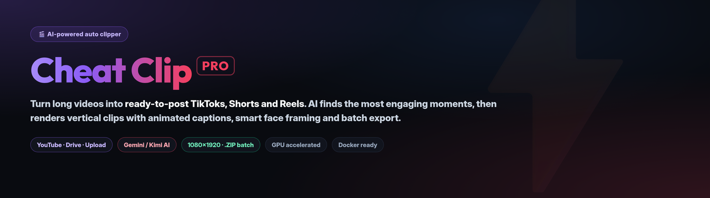
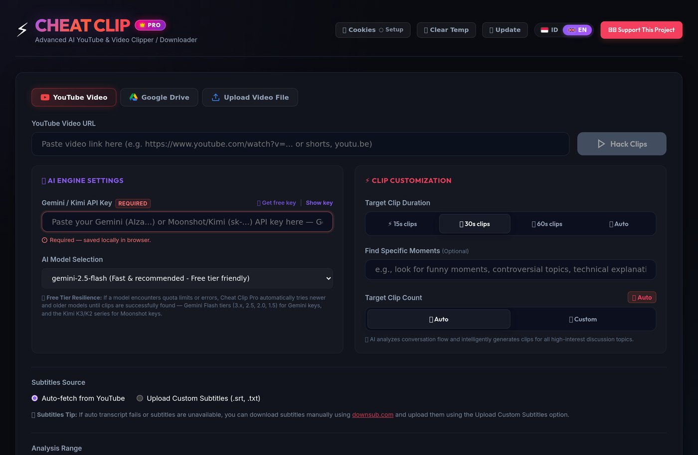
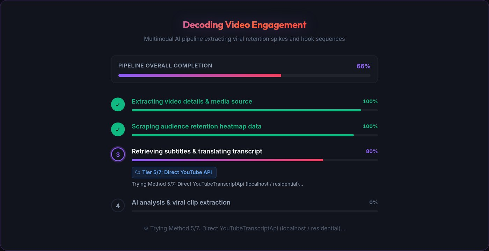
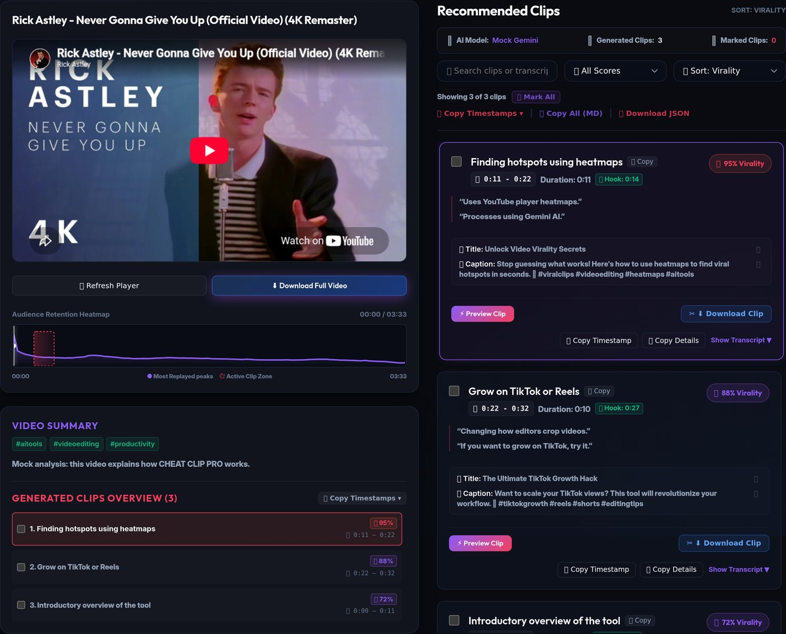
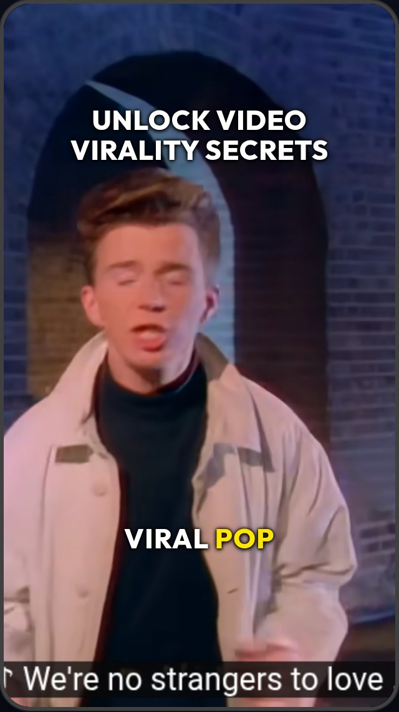
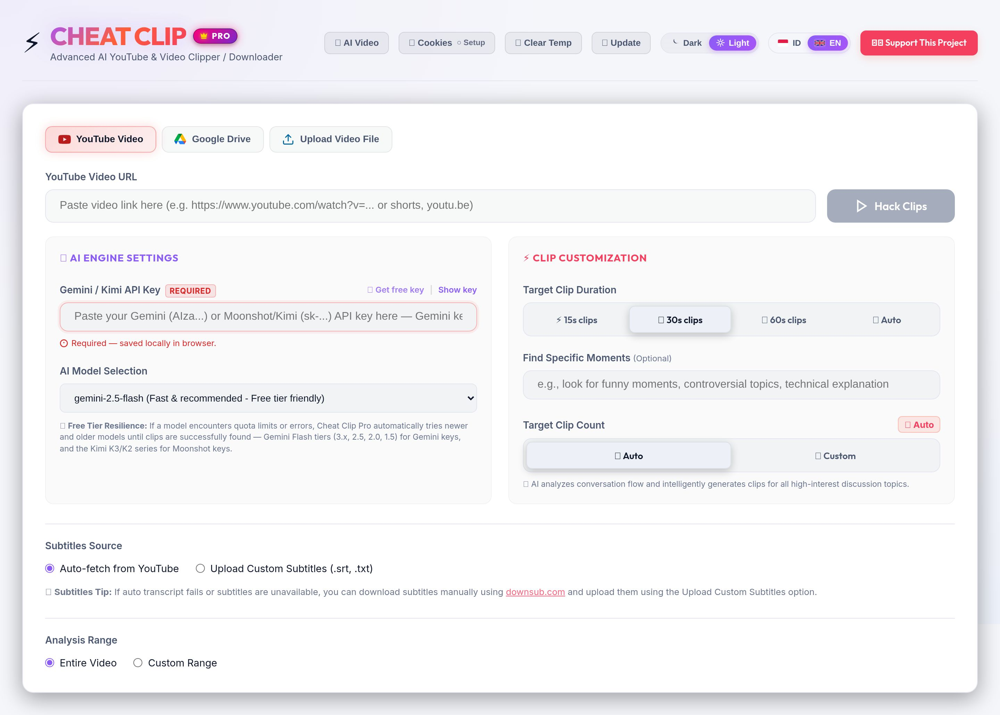
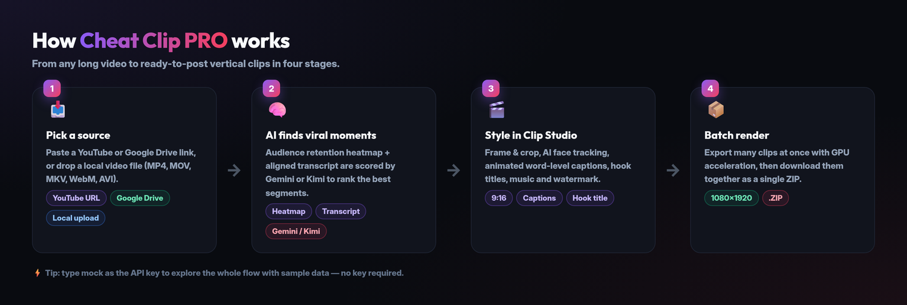
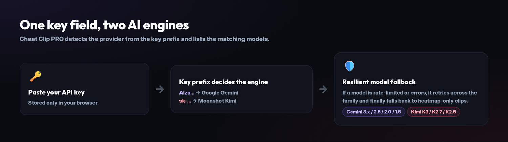
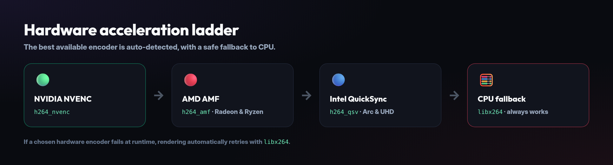
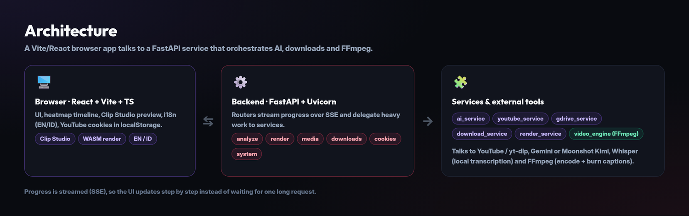

<p align="center">
  
</p>

# 🎬 Cheat Clip PRO

> **AI-powered auto clipper — turn long YouTube videos, Google Drive files, and local uploads into ready-to-post TikToks, Shorts, and Reels with animated subtitles, smart face framing, and batch rendering in minutes.**

Cheat Clip PRO analyzes audience retention data and the video transcript with an AI model — Google Gemini or Moonshot AI's Kimi — to find the most engaging moments, then renders them into vertical 1080×1920 clips — complete with animated word-level captions, hook titles, and optional music and watermark.

This repository is an enhanced fork of [`galihjuansaputra/cheat-clip-pro`](https://github.com/galihjuansaputra/cheat-clip-pro) with a hardened backend, in-browser rendering, Docker deployment, and a test suite.

## 🖼️ Gallery

| Paste a link, pick a duration | Watch the AI pipeline run |
| :---: | :---: |
|  |  |
| **Ranked viral clips + heatmap** | **Clip Studio — vertical preview** |
|  |  |

The whole UI ships in two themes — toggle **Dark / Light** in the header (your choice is remembered per browser):

| Dark (default) | Light |
| :---: | :---: |
|  |  |

---

## ✨ Features

- **AI viral moment detection** — Uses Google Gemini or Moonshot Kimi plus YouTube audience-retention heatmaps to score and rank the highest-engagement segments.
- **Choice of AI engine** — Paste either a Gemini key (`AIza...`) or a Moonshot/Kimi key (`sk-...`) and the provider is auto-detected; pick from the Gemini Flash/Pro tiers or the Kimi K3/K2 family.
- **Resilient AI pipeline** — Automatically falls back across models (Gemini Flash 3.x, 2.5, 2.0, 1.5; Kimi K3 → K2.7 → K2.5) and degrades gracefully to heatmap-based clips if the AI is unavailable.
- **Video → prompt → video** — Turn any source video into a reusable text-to-video prompt (subject, action, setting, camera, lighting, audio and a shot-by-shot list), then feed that prompt to Google Veo to render a brand-new clip. Both directions live in one modal.
- **Multiple input sources** — YouTube URLs, Google Drive share links, or direct video file uploads (MP4, MOV, MKV, WebM, AVI).
- **Multi-tier transcription** — YouTube transcript API → Supadata cloud proxy → Webshare rotating proxy → local Whisper AI, with custom SRT/TXT upload as a manual fallback.
- **Vertical clip studio** — 9:16, 1:1, 4:3, and 16:9 layouts, ambient blurred backdrops, and AI active-speaker face centering.
- **Animated word-level subtitles** — Viral caption styles (Viral Pop, Beast Punch, and more), custom fonts, and precise positioning controls.
- **Hook title banners** — Per-clip AI-generated titles with optional prefix/suffix, duration control, and live preview.
- **Branding & audio** — Watermark logos, background music, and sound effects.
- **Batch rendering** — Render many clips at once and download them together as a single `.ZIP`.
- **Batch prompt extraction** — Feed up to 20 videos at once and get one reusable text-to-video prompt per video; duplicates are dropped and a bad URL fails before any quota is spent.
- **Client-side rendering (WASM)** — Optional FFmpeg WebAssembly renderer runs entirely in the browser for zero server CPU load.
- **Hardware acceleration** — Auto-detects NVIDIA NVENC, AMD AMF, Intel QuickSync, and falls back to universal `libx264` CPU encoding.
- **Light & dark themes** — A header switcher flips the entire UI between a bright paper canvas and a deep-dark workspace; the choice is stored in `localStorage` and applied before first paint. Status colors are tuned per theme so text keeps its contrast in both.
- **Two languages** — Full English and Indonesian UI, switchable from the header.
- **Privacy-first cookies** — YouTube cookies stay in browser `localStorage`; they are passed to `yt-dlp` only for the duration of a request.

### How it fits together



---

## ⚡ Quick Start

### Step 1: Prerequisites

| Tool | Version | Notes |
| --- | --- | --- |
| [Git](https://git-scm.com/) | any | |
| [Node.js](https://nodejs.org/) | 18+ | also runs yt-dlp's YouTube challenge solver |
| [Python](https://www.python.org/) | 3.10+ | 3.11 recommended |
| [FFmpeg](https://ffmpeg.org/) | any | **Must include the `libass` subtitle filter** |
| [yt-dlp](https://github.com/yt-dlp/yt-dlp) | recent | |

> Node.js is used twice: to build the frontend, and as the JavaScript runtime that
> solves YouTube's `n` challenge during downloads. If you install Deno instead,
> that works too — the backend prefers Deno when both are present.

Install FFmpeg and yt-dlp:

- **Windows (PowerShell)**
  ```powershell
  winget install Gyan.FFmpeg
  winget install yt-dlp.yt-dlp
  ```
  *Close and reopen your terminal afterward.*

- **macOS (Terminal)**
  ```bash
  brew install ffmpeg-full yt-dlp
  ```
  `ffmpeg-full` is required for the `libass` subtitle filter used by rendered captions.

- **Linux**
  ```bash
  sudo apt update && sudo apt install ffmpeg
  pip install yt-dlp
  ```

### Step 2: Clone the repository

```bash
git clone https://github.com/antono4/cheat-clip-pro.git
cd cheat-clip-pro
```

### Step 3: Install dependencies

**Frontend**

```bash
npm install
```

**Backend** — a virtual environment is recommended:

- **Windows**
  ```powershell
  python -m venv venv
  venv\Scripts\activate
  pip install -r backend/requirements.txt
  ```

- **macOS / Linux**
  ```bash
  python3 -m venv venv
  source venv/bin/activate
  pip install -r backend/requirements.txt
  ```

### Step 4: Run the app

```bash
npm run dev
```

This starts both servers concurrently:

- **Web app:** [http://localhost:5173](http://localhost:5173)
- **Backend API:** [http://localhost:8000](http://localhost:8000)
- **API docs (Swagger):** [http://localhost:8000/docs](http://localhost:8000/docs)

> On Windows you can also double-click `start.bat`, which resolves the venv, checks for Node.js, and runs `npm run dev`.

---

## 🔑 Get an AI API Key (1 Minute)

Cheat Clip PRO supports two AI providers. Paste whichever key you have — the app detects the provider from the key prefix.



**Google Gemini** (free tier available):

1. Go to [Google AI Studio](https://aistudio.google.com/) and sign in.
2. Click **Get API key** → **Create API key**.
3. Copy the key (starts with `AIzaSy...`).
4. Paste it into the **Gemini / Kimi API Key** field in the app (it is stored only in your browser).

**Moonshot AI Kimi** (Kimi K3, 1M-token context):

1. Go to the [Kimi Open Platform](https://platform.kimi.ai/) and sign in.
2. Create an API key in the console (starts with `sk-...`).
3. Paste it into the same field — the model list switches to the Kimi family automatically.
4. Pick `kimi-k3` for the strongest reasoning, or `kimi-k2.7` for lower latency.

> 💡 **Tip:** Type `mock` in the API Key field to run the **analysis pipeline** with sample data — no API key required. The `mock` key is rejected by the prompt-extraction and video-generation endpoints, which need a real Gemini or Kimi key.

---

## 🎯 How to Use

1. **Pick a source** — Paste a YouTube URL, a Google Drive share link, or upload a video file.
2. **Choose a duration** — `~15s` fast hooks, `~30s` standard shorts, `~60s` story clips, or `✨ Auto` (AI adapts to conversation context).
3. **(Optional) Steer the AI** — Describe the moments you want (e.g. "funny moments", "technical explanations") and set a target clip count.
4. **Click Analyze** — The pipeline extracts metadata, samples the retention heatmap, retrieves and aligns the transcript, then asks the selected AI engine to find and score viral clips.
5. **Customize in Clip Studio** — Frame & crop, face tracking, caption style, hook titles, branding, audio, and hardware acceleration.
6. **Batch Render** — Render all clips, then download them individually or together as a `.ZIP`.

### Video → prompt → video

Click **🎬 AI Video** in the header to open the generator. It has two tabs that feed each other:

- **Video → Prompt** — Paste a YouTube URL, Google Drive link, or uploaded file. Cheat Clip PRO fetches the transcript and asks your AI engine (Gemini or Kimi) to write a portable text-to-video prompt, broken into subject, action, setting, camera, lighting, audio, a negative prompt, and a shot-by-shot list. Pick a visual style from the preset chips (Cinematic, Documentary, Anime, 3D animation, Vintage film, Macro) or type your own, and add extra instructions. Switch to **Batch** to paste many videos at once — one per line — and get a prompt for each; a video that fails is reported on its own and does not stop the rest.
- **Prompt → Video** — Paste any prompt (or press **Generate video from this prompt** to carry one over) and Google Veo renders it. Choose the Veo model, aspect ratio (16:9 or 9:16), resolution, duration (4/6/8s), and how many variants to produce. Progress is polled live and finished clips play inline with a download button.

Veo generation needs a Google Gemini key — Moonshot/Kimi keys can write prompts but cannot render video, and the API returns a clear message if you try.

### Video → prompt from the command line

The `.agents/skills/video-to-prompt/` skill documents this workflow for agents and ships a script that drives a running backend:

```bash
python3 .agents/skills/video-to-prompt/scripts/video_to_prompt.py \
  --url "https://www.youtube.com/watch?v=..." \
  --api-key "$GEMINI_API_KEY" \
  --style "cinematic realism"
```

Pass `--batch urls.txt --wait` to extract prompts for several videos (up to 20 per batch, duplicates are dropped and an invalid URL fails fast), add `--dry-run` to preview what would be submitted, or `--json` for the raw response.

### Clip Studio reference

- **Canvas & aspect ratio** — 9:16 Full, 1:1 Square, 4:3 Standard, 16:9 Letterbox, or true 16:9 Landscape.
- **Framing** — AI auto face/object detection, or manual left/center/right focus.
- **Streamer layouts** — Top facecam / bottom gameplay split, or corner picture-in-picture.
- **Subtitles** — Toggle on/off, choose styles and fonts, force a single line, and set vertical placement.
- **Hook banner** — Enable/disable, edit the active clip title, add prefix/suffix, and control visible duration.
- **Output filename** — Add a prefix/suffix to the generated clip filenames.

### Appearance & language

The header holds two independent switchers that persist per browser:

- **Theme** — `Dark` or `Light`. The theme is applied before the first paint, so there is no flash of the wrong palette. Every surface, border, and status color is defined as a token and re-tuned for each theme.
- **Brand palette** — Emerald primary with a lime secondary and a cyan accent. The brand mark is a monogram "C" with a play triangle, drawn as SVG so it stays sharp in the header, the favicon, and the dark and light themes alike. Text that sits on a brand fill uses a dedicated ink token, so it flips from dark to white when the fill darkens in the light theme.
- **Language** — `ID` (Indonesian) or `EN` (English). All labels, buttons, hints, and error messages are translated.

---

## 🐳 Docker Deployment

Build and run the full stack (frontend bundle + FastAPI + FFmpeg) with Docker Compose:

```bash
export GEMINI_API_KEY=your_key_here   # optional server default (Google Gemini)
export MOONSHOT_API_KEY=your_key_here # optional server default (Moonshot/Kimi K3)
docker compose up --build
```

The app is served at [http://localhost:8000](http://localhost:8000).

The image uses CPU-only PyTorch to stay small, runs as a multi-stage build, mounts named volumes for temp clips, exports, and fonts, and ships a health check against `/api/health`.

---

## ⚙️ Configuration

Copy `backend/.env.template` to `backend/.env` (or create a root `.env`) and set what you need. All keys are optional.

| Variable | Purpose |
| --- | --- |
| `GEMINI_API_KEY` | Server-side default Gemini key (users can still supply their own in the UI). Also required for Veo video generation, which has no Moonshot equivalent. |
| `MOONSHOT_API_KEY` | Server-side default Moonshot/Kimi key, enabling the Kimi K3/K2 model family (users can still supply their own in the UI). |
| `MOONSHOT_BASE_URL` | Override the Kimi endpoint (default `https://api.moonshot.ai/v1`) to route through a proxy or OpenAI-compatible aggregator. |
| `ADMIN_API_KEY` / `CHEAT_CLIP_API_KEY` | Protects destructive endpoints (`/api/system/update`, `/api/system/restart`, `/api/clear-temp`, cleanup). Strongly recommended on public hosts. |
| `SERVER_MODE` | Set to `1`/`true` in containers to block admin actions unless a key is configured. |
| `ALLOWED_ORIGINS` | Comma-separated CORS allowlist (defaults cover local dev). |
| `HOST` / `PORT` | Bind address and port (default `127.0.0.1:8000`; Docker uses `0.0.0.0:8000`). |
| `SUPADATA_API_KEYS` | Comma-separated Supadata keys for cloud transcript fallback (round-robin). |
| `WEBSHARE_PROXY` / `WEBSHARE_USERNAME` / `WEBSHARE_PASSWORD` | Rotating proxy to avoid YouTube datacenter IP bans. |
| `PROXY_URL` | Proxy for YouTube downloads and metadata. Also accepts `WEBSHARE_PROXY` or a synthesized Webshare rotating proxy from `WEBSHARE_USERNAME`/`WEBSHARE_PASSWORD`. Required on datacenter hosts, where YouTube returns `403` to a bare IP. |
| `REQUESTS_CA_BUNDLE` | Custom CA bundle for environments behind an SSL-inspecting proxy. |
| `JOB_TTL_SECONDS` / `JOB_MAX_ENTRIES` | Tuning for the in-memory job registry. |
| `TEMP_MAX_AGE_SECONDS` / `TEMP_STORAGE_QUOTA_GB` / `CLEANUP_INTERVAL_SECONDS` | Temp-file cleanup worker (TTL, quota ceiling, interval). |
| `EMOJI_FONT_PATH` | Path to a color emoji font for overlay rendering. |

### Admin endpoint security

- If `ADMIN_API_KEY` (or `CHEAT_CLIP_API_KEY`) is set, destructive endpoints require an `X-API-Key: <key>` header.
- If no key is set, those endpoints are allowed **only** for local desktop installs (loopback client, non-server environment). In server/Docker mode they return `403`.

---

## 🔌 API Reference

The backend exposes a documented FastAPI service. Highlights:

| Method | Endpoint | Description |
| --- | --- | --- |
| `POST` | `/api/analyze` | Analyze a video and stream progress/results via SSE. |
| `POST` | `/api/upload-video` | Upload a local video file. |
| `POST` | `/api/download-raw-video` | Download the full source video. |
| `POST` | `/api/download-raw-clip` | Download a clean clip segment (no crop/subtitles). |
| `POST` | `/api/render-batch` | Start a batch render. |
| `GET` | `/api/render-progress/{batch_id}` | Stream render progress (SSE). |
| `GET` | `/api/download-batch-zip/{batch_id}` | Download all rendered clips as a `.ZIP`. |
| `GET` | `/api/hardware-accel` | Report available hardware encoders. |
| `GET` | `/api/models` | List available AI models for a key (Gemini or Kimi, auto-detected; override with `?provider=`). |
| `POST` | `/api/generate-prompt` | Extract a structured text-to-video prompt from a YouTube/GDrive/uploaded video. |
| `POST` | `/api/generate-prompts-batch` | Start a batch of prompt extractions from a list of video URLs (returns a `batch_id`). |
| `GET` | `/api/generate-prompts-batch-status/{batch_id}` | Poll a prompt batch for per-video progress and results. |
| `GET` | `/api/video-models` | List the Veo models available for video generation. |
| `POST` | `/api/generate-video` | Start a Veo text-to-video job from a prompt (returns a `job_id`). |
| `GET` | `/api/generate-video-status/{job_id}` | Poll a video generation job for progress and results. |
| `GET` | `/api/download-generated/{file_name}` | Download a generated video. |
| `GET`/`POST`/`DELETE` | `/api/cookies` | Manage YouTube cookies. |
| `GET` | `/api/system/version` · `/api/system/check-update` | Version and update status. |
| `POST` | `/api/system/update` · `/api/system/restart` | Admin: update and restart. |
| `GET` | `/api/health` | Health check. |

Full interactive docs are available at `/docs` (Swagger UI) and `/redoc`.

---

## 🖥️ Hardware Acceleration

Cheat Clip PRO auto-detects the best available encoder and lets you override it in Clip Studio:



1. **NVIDIA NVENC** — `h264_nvenc`
2. **AMD AMF** — `h264_amf` (Radeon GPUs & Ryzen CPUs)
3. **Intel QuickSync** — `h264_qsv` (Arc & UHD Graphics)
4. **CPU software** — `libx264` universal fallback

If a chosen hardware encoder fails at runtime, the pipeline automatically falls back to `libx264`.

---

## ❓ Troubleshooting

**"Failed to render video" / `The system cannot find the file specified`**
`ffmpeg` or `yt-dlp` is missing. Install both (see [Prerequisites](#step-1-prerequisites)) and reopen your terminal.

**`No such filter: 'subtitles'`**
FFmpeg was built without the `libass` subtitle filter. On macOS run `brew install ffmpeg-full` and restart the backend; the app prefers the subtitle-capable binary.

**"Sign in to confirm you're not a bot"**
YouTube is throttling unauthenticated downloads. Click the 🍪 **Cookies** button, export your cookies with a browser extension such as *Get cookies.txt locally*, and paste them into the app to unlock 1080p downloads.

**`Failed to download video clip segment from YouTube` / `HTTP error 403 Forbidden`**
YouTube refused the media URL. Three causes, in order of likelihood:

1. **Your IP is flagged.** Datacenter, cloud, VPN and some shared connections are blocked outright, and no cookie fixes it. Set `PROXY_URL` (or `WEBSHARE_PROXY`, or `WEBSHARE_USERNAME`/`WEBSHARE_PASSWORD`) in `backend/.env` so downloads exit through a residential IP, then restart the backend. Downloads, metadata and transcripts all use the same proxy.
2. **Stale cookies.** Import fresh YouTube cookies with the 🍪 **Cookies Manager** button.
3. **No JavaScript runtime.** yt-dlp has to run YouTube's `n` challenge in a JavaScript runtime, and **Deno or Node.js must be on `PATH`** — that is what solves the challenge. `yt-dlp-ejs` (the solver scripts) ships with `requirements.txt`, so reinstalling it changes nothing; the missing piece is the runtime. Without one yt-dlp omits formats and logs `n challenge solving failed`, and the download fails with `403`. Install [Deno](https://deno.land/) (`winget install DenoLand.Deno`, `brew install deno`, or `curl -fsSL https://deno.land/install.sh | sh`) or Node.js, then restart the backend. Check `GET /api/health` — it reports the detected `js_runtime` (`null` means none was found).

If only *some* clips fail, retry — YouTube URLs expire after a few minutes, so a long batch can outlive the links it was given.

**Analysis fails or returns no clips**
Check your Gemini or Kimi API key and quota. The app retries across multiple models (Gemini Flash tiers or the Kimi K3/K2 series), and will fall back to heatmap-based clips if the AI cannot be reached. You can also upload a custom `.srt`/`.txt` subtitle file if auto-transcription fails.

**Does it work on AMD GPUs and Macs?**
Yes — AMD (`h264_amf`), Intel (`h264_qsv`), and Apple/CPU (`libx264`) are all supported. Switch encoders anytime in Render Settings.

**The page is blank / white after `npm run dev` (Windows or macOS)**
A module import resolved to the wrong file because of a case-insensitive filesystem. Vite tries `.ts` before `.tsx`, so if two modules differ only by letter case the browser loads the wrong one and the app never mounts. The fix already shipped: context providers live in `LanguageProvider.tsx` / `ThemeProvider.tsx`. If you add modules, keep filenames unique regardless of case — `npm run test` runs a guard that fails on case-only collisions. See the browser console for `does not provide an export named` errors.

**`[PARSE_ERROR] Encountered diff marker` in the Vite overlay**
A leftover Git conflict marker (`<<<<<<<`, `=======`, `>>>>>>>`) is in a source file — usually the remains of an interrupted `git stash pop`, `git pull --rebase --autostash`, or a half-finished merge. Detect and repair it with the bundled helper:

```bash
npm run fix-conflicts          # list the offending files and lines (dry run)
npm run fix-conflicts -- --fix # back up local edits, then reset to origin/master
```

The `--fix` run first saves your current working tree on a `backup/pre-conflict-fix-<timestamp>` branch, so nothing is lost; delete that branch once you no longer need it. To repair by hand instead, open the reported file and remove the three marker lines, keeping the version you want.

---

## 🧪 Tests

Backend tests use `pytest`:

```bash
pip install -r requirements-test.txt   # light subset: no torch/cv2/whisper
pytest tests/
```

The backend suite runs on Linux **and on Windows x64** in CI (the
`backend-windows` job on `windows-latest`). Windows is the primary desktop
target (`start.bat`, winget FFmpeg) and its default text encoding is the ANSI
code page, not UTF-8, so the tests pin two Windows-only rules:

- every text-mode `subprocess` call passes `encoding="utf-8"`, so child output
  from yt-dlp/ffmpeg is not decoded as cp1252 (which raises
  `UnicodeDecodeError` on non-Latin-1 clip titles);
- failure output is summarised from the tail, where yt-dlp/ffmpeg put the real
  reason, not the long media URL printed before it.

Frontend unit tests use `vitest`:

```bash
npm run test
```

Type checking and a production build are also part of CI:

```bash
npx tsc -b
npm run lint
npm run build
```

---

## 🏗️ Architecture



---

## 📁 Project Structure

```
cheat-clip-pro/
├── backend/                 # FastAPI service
│   ├── routers/             # analyze, render, media, cookies, downloads, system
│   ├── services/            # ai, render, download, youtube, gdrive, system
│   ├── schemas/             # Pydantic request/response models
│   ├── utils/               # SSE, media paths, proxy, heatmap helpers
│   ├── cascades/ fonts/     # face-detection cascades and bundled fonts
│   ├── video_engine.py      # FFmpeg download / transcode / render engine
│   └── main.py              # App entrypoint
├── src/                     # React + TypeScript frontend
│   ├── components/          # Clip studio, trimmer, heatmap, modals
│   ├── services/            # client-side (WASM) renderer
│   ├── utils/               # API client, audio extraction, cookie utils
│   ├── types/               # Hand-written YouTube IFrame API types
│   ├── locales/             # English & Indonesian translations
│   └── theme/               # Light/dark theme provider
├── scripts/                 # Dev backend launcher
├── tests/                   # pytest suite
├── requirements-test.txt    # Light deps for CI (no torch/whisper)
├── .github/workflows/       # CI: backend tests (Linux + Windows x64), frontend tsc/test/build, lint
├── AGENTS.md                # Repo notes for agents
├── Dockerfile               # Multi-stage build
└── docker-compose.yml
```

---

## 📄 License

Distributed under the **MIT License**. Free for personal and commercial use. See [LICENSE](LICENSE).

Originally created by [Galih Juan Saputra](https://github.com/galihjuansaputra); this fork adds backend hardening, in-browser rendering, Docker support, CI, and a frontend plus backend test suite.
